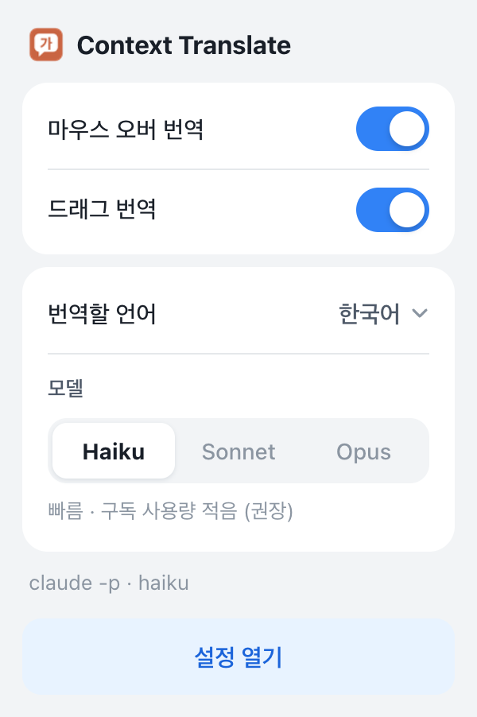

# Context Translate

웹페이지에서 **단어에 마우스를 올리거나 문장을 드래그하면**, 앞뒤 문맥을 보고 알맞은 뜻으로 번역해 툴팁으로 보여주는 Chrome 확장입니다.
번역은 내 컴퓨터에 설치된 **Claude Code(`claude -p`)** 가 합니다. API 키 없이 본인 구독으로 동작합니다.

> A Chrome extension that translates the word under your cursor (or your selection) in context. Translation runs through your own locally installed Claude Code (`claude -p`) subscription. macOS only. UI is in Korean.

| 마우스 오버 — 문맥에 맞는 뜻 | 드래그 — 자연스러운 번역 |
|---|---|
|  |  |

<picture>
  <source media="(prefers-color-scheme: dark)" srcset="docs/images/popup-dark.png">
  
</picture>

- **문맥 번역**: "run a quick errand"의 run은 "달리다"가 아니라 "(볼일을) 처리하다". 다른 주요 뜻도 한 줄로 함께 보여줍니다.
- **빠름**: 미리 띄워 둔 `claude` 프로세스를 써서 보통 1~2초 안에 뜹니다. 기다리는 동안 경과 시간이 표시되고, 3초가 넘으면 안내가 나옵니다.
- **여러 언어**: 원문 언어는 자동으로 알아내고, 번역할 언어는 한국어·English·日本語·中文 등 20개 중에서 툴바 아이콘에서 바로 바꿀 수 있습니다.
- **모델 선택**: 툴바 아이콘에서 Haiku / Sonnet / Opus (각 계열의 최신 모델) 중 고를 수 있습니다.
- 긴 글(최대 20,000자)도 드래그해서 번역할 수 있고, 같은 단어·문맥은 다시 묻지 않고 바로 보여줍니다.

## 필요한 것

- **macOS**
- Chrome 계열 브라우저 (Chrome, Edge, Brave, Arc, Whale, Chromium)
- [Node.js](https://nodejs.org) 18 이상
- [Claude Code](https://claude.com/claude-code) 설치 + 로그인 (Pro/Max 등 Claude 구독)
  - 설치 후 터미널에서 `claude`를 한 번 실행해 로그인해 두세요.

## 설치

```bash
git clone https://github.com/ysh038/context-translate.git
cd context-translate
npm run setup
```

`npm run setup`이 확인, 빌드, 중계 프로그램 등록까지 한 번에 하고 확장 관리 페이지를 열어 줍니다. 남은 한 단계는 브라우저에 확장을 불러오는 것입니다 (처음 한 번만).

1. 확장 관리 페이지(`chrome://extensions`, Edge는 `edge://extensions`)에서 **개발자 모드**를 켭니다.
2. **압축해제된 확장 프로그램을 로드합니다**를 누르고 `dist/personal` 폴더를 선택합니다.
   경로는 setup이 클립보드에 복사해 둡니다. 폴더 선택 창에서 `⌘⇧G` → `⌘V` → Enter.
3. 열려 있던 페이지를 새로고침하고 영어 단어에 마우스를 올려 보세요.

### 업데이트

```bash
git pull
npm run setup
```

그다음 확장 관리 페이지에서 확장 카드의 ↻(새로고침)을 누르면 됩니다.

## 사용법

| 동작 | 결과 |
|---|---|
| 단어 위에 마우스를 올리고 잠시 멈춤 (기본 0.45초) | 1줄: 문맥상 뜻 + 품사 / 2줄: 다른 주요 뜻 |
| 문장·문단 드래그 | 자연스러운 의역 (단어 하나만 드래그·더블클릭하면 사전처럼) |
| 툴팁의 글자가 아닌 곳(위쪽 줄, 여백)을 끌기 | 툴팁 옮기기 — 옮긴 툴팁은 화면의 그 자리에 머물고 스크롤해도 따라오지 않음 |
| 툴팁 글자를 끌기 | 글자 선택 (복사용) |
| 툴팁의 📌 버튼 | **화면에 고정** — 다음 번역부터 항상 그 자리에 뜸 (사전 창처럼). 다시 누르면 글자 옆에 뜨기로 |
| `Esc` | 툴팁 닫기 |
| `Alt+Shift+H` | 마우스 오버 번역 켜기/끄기 (툴바 아이콘에 OFF 표시) |

툴팁 오른쪽 위 숫자는 번역 요청부터 걸린 시간입니다.

**설정** (툴바 아이콘 → 설정 열기)

- 번역할 언어 (기본: 한국어, 이미 한국어면 영어로 — 둘 다 바꿀 수 있음. 번역할 언어는 툴바 팝업에서도 변경)
- 마우스 오버 대기 시간, `Alt`/`Shift`/`⌘`를 누른 채로만 번역하기
- 문맥을 얼마나 함께 보낼지 (없음 / 해당 문장 / 앞뒤 ±350자)
- 드래그하면 바로 번역 / [번역] 버튼을 눌러야 번역

**모델** (툴바 아이콘 팝업)

| 모델 | 특징 |
|---|---|
| Haiku (기본) | 빠르고 구독 사용량이 적음 |
| Sonnet | 더 자연스러운 번역 |
| Opus | 가장 정확, 구독 사용량이 많음 |

단어 하나 기준으로는 세 모델 모두 1~2초 안팎으로 속도 차이가 크지 않았습니다 (2026-11 측정).

## 문제 해결

| 증상 | 해결 |
|---|---|
| "중계 프로그램이 설치되지 않았습니다" | `npm run setup`을 다시 실행하고 확장을 새로고침 |
| "Native host has exited" / 연결이 끊김 | `npm run setup` 다시 실행. 그래도 안 되면 아래 로그 확인 |
| "Claude Code에 로그인되어 있지 않습니다" | 터미널에서 `claude` 실행 후 로그인 |
| "Claude 구독 사용 한도에 도달했습니다" | 구독 한도가 초기화될 때까지 대기, 또는 Haiku로 변경 |
| 툴팁이 아예 안 뜸 | 확장을 불러오기 전에 열려 있던 탭은 새로고침. `chrome://` 페이지, 웹 스토어, PDF 뷰어에서는 동작하지 않음 |
| 다른 브라우저를 새로 설치함 | `npm run setup`을 다시 실행 (실행 시점에 설치된 브라우저에만 등록됨) |

로그(번역한 텍스트는 남기지 않음): `~/Library/Logs/claude-tooltip-translate/` (`host.log`, `host.stderr.log`)

터미널에서 claude 연결만 따로 확인: `npm run host:test -- "She sat on the bank of the river."`

## 어떻게 동작하나

```
웹페이지 ─(content script)─▶ 확장 백그라운드 ─(native messaging)─▶ 중계 프로그램 ─▶ claude -p
```

- 브라우저 확장은 직접 프로그램을 실행할 수 없어서, Chrome의 [native messaging](https://developer.chrome.com/docs/extensions/develop/concepts/native-messaging)으로 작은 Node 중계 프로그램을 띄웁니다. setup이 이것을 `~/Library/Application Support/claude-tooltip-translate/`에 설치하고 브라우저에 등록합니다.
- 중계 프로그램은 `claude -p` 프로세스를 하나 미리 띄워 두었다가 요청이 오면 바로 보내고, 답이 오면 그 프로세스를 끝내고 다음 것을 다시 띄워 둡니다. 그래서 매번 시작을 기다리지 않고, 요청끼리 대화가 쌓이지도 않습니다.
- `claude`는 도구·MCP·사용자 설정 없이(`--tools "" --strict-mcp-config --setting-sources ""`), 빈 임시 폴더에서 번역 프롬프트로만 실행됩니다.
- 번역하려는 텍스트와 주변 문맥은 `claude`를 통해 Anthropic으로 전송됩니다. 민감한 페이지에서는 마우스 오버 번역을 꺼 두세요(`Alt+Shift+H`).

## 제거

```bash
npm run host:uninstall
```

확장 관리 페이지에서 확장도 삭제하면 끝입니다.

## 개발

| 명령 | 하는 일 |
|---|---|
| `npm run dev` | 개인용 빌드를 watch 모드로 (`dist/personal`) |
| `npm run build` | 모든 에디션 빌드 → `dist/<에디션>` |
| `npm test` | 상업용 빌드 검사 + 중계 프로그램 테스트 + 브라우저 e2e 테스트 (처음 한 번 `npx playwright install chromium`) |

테스트는 가짜 `claude`와 가짜 API 서버를 쓰므로 구독 사용량을 쓰지 않습니다. 구조와 결정 사항은 [CLAUDE.md](CLAUDE.md), 로드맵은 [docs/PLAN.md](docs/PLAN.md)에 있습니다.
같은 코드에서 API 키 방식의 `store` 에디션(`npm run build:store`)도 빌드되며, 여기에는 `claude -p` 관련 코드가 들어가지 않습니다(`npm run check:store`로 검사).

## 주의

- **Anthropic과 관련 없는 개인 프로젝트입니다.** Claude는 Anthropic의 상표입니다.
- 이 확장은 각자의 컴퓨터에서 각자 로그인한 공식 Claude Code(`claude -p`)를 자동으로 호출합니다. Anthropic은 구독(Free/Pro/Max) 자격 증명을 다른 제품·도구에서 쓰는 것을 제한하고 있고, 이런 자동 호출이 허용되는지는 문서에 명확하지 않습니다. 사용 전에 [Claude Code 법적 고지·약관](https://code.claude.com/docs/en/legal-and-compliance)을 직접 확인하고 본인 판단으로 사용하세요.
- 번역할 때마다 구독 사용량을 씁니다.

## 라이선스

[MIT](LICENSE)
